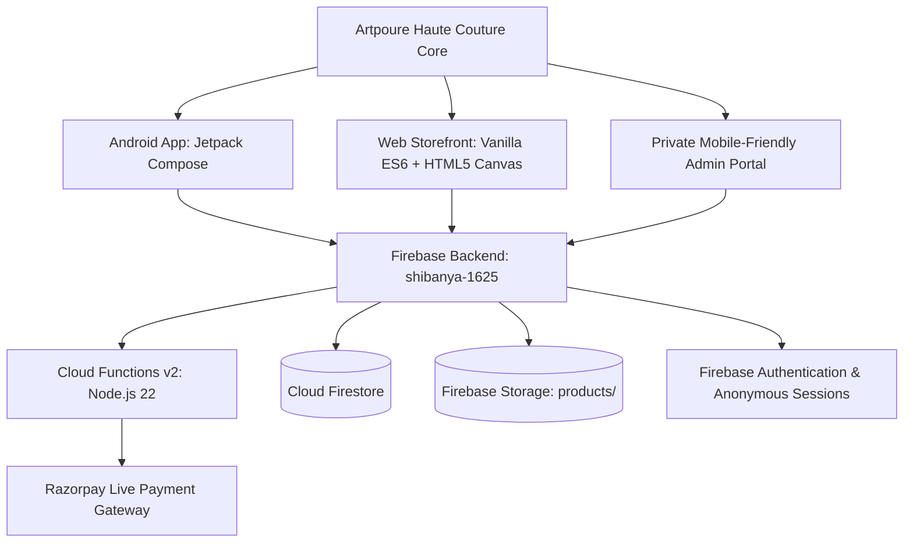

# Artpoure • Unified Architecture & Implementation Report

> **Core Architectural Principle**: Continuous 1:1 synchronization between the Android application (`com.artpoure.store`) and the Web storefront (`artpoure-web`). Every design token, data model, motion curve, validation rule, merchandising feature, and security policy is mirrored across platforms.

---

## 1. Executive Architecture Overview

Artpoure is a bespoke luxury Indian ethnic wear omnichannel platform uniting a native Jetpack Compose Android client, a modern responsive ES6 web application, and a serverless Google Cloud / Firebase infrastructure.



---

## 2. Platform Architecture Breakdown

### 2.1 Android Application (`com.artpoure.store`)
- **UI Framework**: Modern Jetpack Compose with Material 3 theming (`VastraTheme`), custom spring physics, and dynamic top/bottom navigation morphing.
- **State Management**: Kotlin Coroutines `StateFlow` and `SharedFlow` coordinated via `StoreViewModel`, combined with `SharedPreferences` for local user preferences (gender, location, affinity).
- **Navigation Architecture**:
  - `MainActivity` Compose Navigation (`NavHost`) coordinating routes: `home`, `artclusive`, `cart`, `checkout`, `profile`, `wishlist`, `product_detail/{productId}`.
  - Custom **Starburst Supernova Transition Engine** (`StarExplosionOverlay`): 2,000ms theatrical slow-motion radial detonation transitioning from catalog cards into Haute Couture detail views.
- **Media Engine**: Seamless looping atmospheric video background via Google ExoPlayer (`LoopingVideoBackground.kt`) playing `R.raw.exclusive_dark` / `R.raw.exclusive_light`.

### 2.2 Web Storefront (`artpoure-web`)
- **Technology Stack**: High-performance Vanilla ES6 modules, CSS Custom Properties, and responsive CSS Grid/Flexbox with zero bloated UI frameworks.
- **Canvas Physics**: Fullscreen HTML5 Canvas particle engine reproducing the Starburst Supernova transition 1:1 with Android.
- **Hosting & CI/CD**: Firebase Hosting automated deployment via GitHub Actions on every push to `main`.
- **Mirroring**: Mirrored under `MyApp/web/` within the Android project workspace for immediate cross-platform validation.

### 2.3 Private Mobile-Friendly Admin Portal (`public/admin.html`, `admin.js`, `admin.css`)
- **Stealth Access**: Protected by `<meta name="robots" content="noindex, nofollow">` with zero storefront discovery links.
- **Security Auth Gate**: Strict Firebase Google Authentication enforcing email verification (`email_verified == true`) and an authoritative admin allowlist:
  - `artpoure@gmail.com`
  - `artpoure.official@gmail.com`
  - `admin@artpoure.in`
  - `shibmalyaananya@gmail.com`
  - `shibmalyada@gmail.com`
  - `deyananya98@gmail.com`
- **Catalog Management (Tab 1)**:
  - Full schema editing: `id`, `editorialTitle`, `fullName`, `category`, `priceInr`, specs, care, description, available options.
  - **Merchandising Controls**:
    - `gender`: Target demographic selection (`WOMEN`, `MEN`, `KIDS`, `UNISEX`).
    - `inNewArrivals`: 1-click toggle and permanent form checkbox to feature items in the auto-cycling hero carousel.
    - `isCurated`: Pin item to the Curated Picks horizontal showcase.
    - `isTrending`: Pin item to the Trending curation showcase.
    - `occasionTags`: Comma-separated tags (e.g., `Wedding`, `Festive`, `Hand-Painted`, `Gifting`) feeding the personalization engine.
  - **Dynamic Multi-Color Variant Builder**:
    - Interactive color pickers (`<input type="color">`) for `swatchHex` and `canvasHex`.
    - In-stock availability toggles.
    - Multi-image gallery upload per color variant (`images: [...]`).
  - **Client-Side WebP Compression (`compressImageToWebP`)**:
    - Automatically resizes images proportionally to a maximum dimension of 1,200px.
    - Compresses to `image/webp` at 0.82 quality on an in-memory HTML5 Canvas before uploading to Firebase Storage.
    - Reduces Storage consumption and client bandwidth by ~70–80% while retaining high-fidelity fabric zoom textures.
- **Live Orders & Fulfillment Manager (Tab 2)**:
  - Dual status tracking:
    - **Fulfillment Status**: `CONFIRMED`, `PACKED`, `SHIPPED`, `DELIVERED`, `CANCELLED`.
    - **Payment Status**: `COD: PENDING_COD`, `COD: COLLECTED`, `PREPAID: PAID`, `PREPAID: PENDING`, `REFUNDED`, `FAILED`.
  - Inline tracking updates: Courier name and AWB tracking number persisted directly to Firestore `orders/{orderId}`.
  - Courier settlement workflow: Admin marks COD orders as `COLLECTED` upon courier cash payout, setting `paidAt = serverTimestamp()`.
- **Atelier Consultations Tracker (Tab 3)**:
  - Real-time appointment cards with click-to-call phone triggers, preferred date, custom weave requests, and status controls (`CONFIRMED`, `COMPLETED`, `CANCELLED`).

---

## 3. Product Catalog & Editorial Feed Engine

### 3.1 Live Real-Time Firestore Synchronization
- Both Android (`StoreViewModel.kt`) and Web (`app.js`) attach real-time snapshot listeners to the Firestore `products` collection.
- Fallback resilience: If offline or during initial bootstrap, seamlessly falls back to the curated `MockCatalogRepository` / `FALLBACK_PRODUCTS`.
- Bidirectional Variant Normalization: Automatically maps top-level `imageUrl` into color variants and synthesizes default variants if individual swatches are omitted.

### 3.2 Dynamic Editorial Categories & Drawer Architecture
- Categories supported: `FOR_YOU`, `WOMEN`, `MEN`, `KIDS`, `FOOTWEAR`, `ACCESSORIES`.
- Selecting a category expands an animated sub-category shelf that pushes lower content downward via spring physics without layout clipping.
- **Category `WOMEN` Scope**: Encompasses all women's ethnic and western collections, including Sarees, Kurta Sets, Dresses, Tops & Jeans, Lehengas, and women's accessories.
- **Hero Showcase Hiding**: Selecting any specific sub-category (e.g., `Sarees`, `Kurta sets`) automatically hides the top New Arrivals hero banner, focusing the screen purely on the selected collection.

### 3.3 Hybrid Curated Picks Personalization Engine
Both platforms implement an identical multi-signal scoring algorithm with zero-empty fallback:

$$\text{Score} = (50 \times \text{isCurated}) + (20 \times \text{isCustomOrHandcrafted}) + (10 \times \text{isFresh}_{<14\text{d}}) + (25 \times \text{AffinityMatch}) + (5 \times \text{GenderMatch})$$

- **Local Affinity Signals**: Tracks viewed product IDs, category affinities, and occasion tags in local client storage (`SharedPreferences` / `localStorage`).
- **Zero-Empty Guarantee**: If fewer than 4 items match the curated filter, the system automatically falls back to the atelier's newest bespoke and custom creations, ensuring the `Curated Picks` horizontal rail is never blank.

### 3.4 Editorial Luxury Empty State & Waitlist Capture
- When zero pieces exist in a selected sub-category or niche filter, all standard headers hide and a luxury Artpoure Atelier **COMING SOON** card is rendered spanning the viewport.
- **Interactive Retention Actions**:
  1. `✦ NOTIFY ME ON LAUNCH`: Opens the **Atelier Waitlist** dialog. Captures user's WhatsApp number or email and records to Firestore `/waitlist` collection via authenticated or anonymous session.
  2. `BOOK ATELIER CONSULTATION`: Triggers the bespoke 1-on-1 virtual consultation scheduler.
  3. `EXPLORE ALL COLLECTIONS`: Resets category filters to `FOR_YOU` / `ALL`.

---

## 4. Payment & Checkout Architecture

### 4.1 Authoritative Pricing & Free Shipping Rules
To eliminate discrepancies between server and client platforms, pricing rules are centralized in Cloud Functions (`functions/index.js`), Android (`StorePricingPolicy.kt`), and Web (`PRICING_CONFIG`):

| Pricing Parameter | Value | Rule Description |
| :--- | :--- | :--- |
| **Free Shipping Threshold** | `₹2,999` | Orders at or above ₹2,999 receive complimentary Silk Mark insured shipping. |
| **Standard Shipping Fee** | `₹149` | Applied automatically to orders under ₹2,999. |
| **COD Booking Token** | `₹299` | Authoritative advance deposit required for Cash on Delivery orders to deter courier RTO. |
| **Promo Code `FIRST10`** | `10%` | Flat 10% discount on cart subtotal, rounded to nearest whole rupee. |

### 4.2 Razorpay Live Payment Gateway (`rzp_live_U24HQteyWphATZ`)
- **Server-Authoritative Order Creation** (`createRazorpayOrder`):
  - Cloud Function v2 computes grand total from authoritative Firestore catalog prices.
  - Writes pending order to Firestore `orders/{orderId}` via Firebase Admin SDK.
- **Cryptographic Signature Verification** (`verifyRazorpayPayment`):
  - Validates HMAC-SHA256 signature of `${razorpayOrderId}|${razorpayPaymentId}` against `RAZORPAY_KEY_SECRET`.
  - Secret keys are secured via Google Cloud Secret Manager (`defineSecret`) with zero client-side exposure.
- **Client Handlers**: Handled via official Razorpay Android SDK (`com.razorpay:checkout:1.6.41`) and Razorpay Web Standard Checkout modal.

### 4.3 Cash on Delivery (COD) Serverless Gateway (`createCodOrder`)
- Clients never write directly to the `orders` collection.
- COD orders trigger the `createCodOrder` Cloud Function v2, which validates items, computes shipping, calculates `codAdvanceInr` (₹299) and `codBalanceInr` (remaining balance due on delivery), writes `status: "CONFIRMED"` and `paymentStatus: "PENDING_COD"`, and clears the user's cart.

---

## 5. Security Rules & Access Control

### 5.1 Cloud Firestore Production Security Rules (`firestore.rules`)
```rules
rules_version = '2';

service cloud.firestore {
  match /databases/{database}/documents {

    function isAuthenticated() {
      return request.auth != null;
    }

    function isOwner(userId) {
      return isAuthenticated() && request.auth.uid == userId;
    }

    function isAdmin() {
      return isAuthenticated() && (
        request.auth.token.admin == true ||
        request.auth.token.role == "admin" ||
        (
          request.auth.token.email_verified == true &&
          request.auth.token.email in [
            "artpoure@gmail.com",
            "artpoure.official@gmail.com",
            "admin@artpoure.in",
            "shibmalyaananya@gmail.com",
            "shibmalyada@gmail.com",
            "deyananya98@gmail.com"
          ]
        )
      );
    }

    // Public catalog (Admin write only)
    match /products/{productId} {
      allow read: if true;
      allow write: if isAdmin();
    }
    match /categories/{categoryId} {
      allow read: if true;
      allow write: if isAdmin();
    }
    match /banners/{bannerId} {
      allow read: if true;
      allow write: if isAdmin();
    }
    match /promotions/{promoId} {
      allow read: if true;
      allow write: if isAdmin();
    }

    // User accounts & carts
    match /users/{userId} {
      allow read, write: if isOwner(userId) || isAdmin();
      match /{allSubcollections=**} {
        allow read, write: if isOwner(userId) || isAdmin();
      }
    }

    // Orders: Created exclusively by Cloud Functions Admin SDK; admin can update fulfillment
    match /orders/{orderId} {
      allow read: if isAuthenticated() && (
        resource.data.userId == request.auth.uid ||
        isAdmin()
      );
      allow create, delete: if false;
      allow update: if isAdmin();
    }

    // Atelier consultations
    match /appointments/{aptId} {
      allow create: if (
        request.resource.data.status == 'CONFIRMED' &&
        request.resource.data.clientPhone.matches('^[0-9]{10}$')
      );
      allow read, update: if isAuthenticated() && (
        resource.data.userId == request.auth.uid ||
        isAdmin()
      );
      allow delete: if isAdmin();
    }

    // Atelier launch waitlist
    match /waitlist/{waitlistId} {
      allow create: if isAuthenticated();
      allow read, write: if isAdmin();
    }

    match /{document=**} {
      allow read, write: if false;
    }
  }
}
```

### 5.2 Firebase Storage Rules (`storage.rules`)
```rules
rules_version = '2';

service firebase.storage {
  match /b/{bucket}/o {

    function isAuthenticated() {
      return request.auth != null;
    }

    function isAdmin() {
      return isAuthenticated() && (
        request.auth.token.admin == true ||
        request.auth.token.role == "admin" ||
        (
          request.auth.token.email_verified == true &&
          request.auth.token.email in [
            "artpoure@gmail.com",
            "artpoure.official@gmail.com",
            "admin@artpoure.in",
            "shibmalyaananya@gmail.com",
            "shibmalyada@gmail.com",
            "deyananya98@gmail.com"
          ]
        )
      );
    }

    // Public catalog images
    match /products/{allPaths=**} {
      allow read: if true;
      allow write: if isAdmin() &&
        request.resource.size < 10 * 1024 * 1024 &&
        request.resource.contentType.matches('image/.*');
    }

    match /{allPaths=**} {
      allow read, write: if false;
    }
  }
}
```

---

## 6. Verification, Testing & CI/CD Status

- **Android Client**:
  - Gradle compile: `./gradlew compileDebugKotlin` (0 errors).
  - Unit tests: `./gradlew :app:testDebugUnitTest` (6 passed, 0 failed).
  - APK build: `./gradlew :app:assembleDebug` completed successfully.
- **Web Client**:
  - Syntactic validation: `node --check public/app.js` and `public/admin.js` pass with exit code 0.
  - File hash integrity: `MyApp/web/` is synchronized byte-for-byte with `artpoure-web/public/`.
- **Deployment Status**:
  - GitHub Remote: `https://github.com/Shibmalya/artpoure-web` on branch `main`.
  - Continuous Deployment: Every commit pushed to `main` triggers GitHub Actions deploying to Firebase Hosting (`shibanya-1625`).
